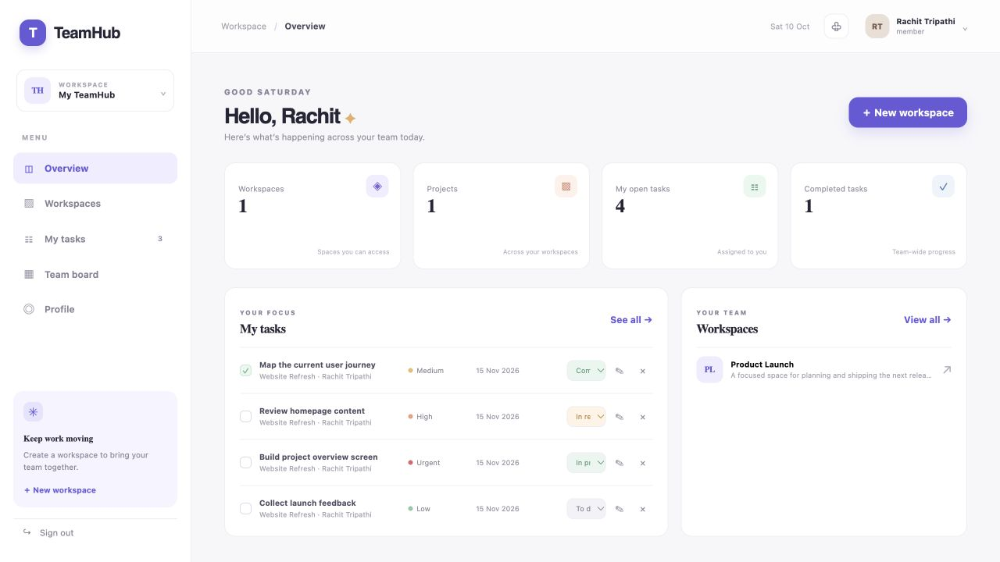
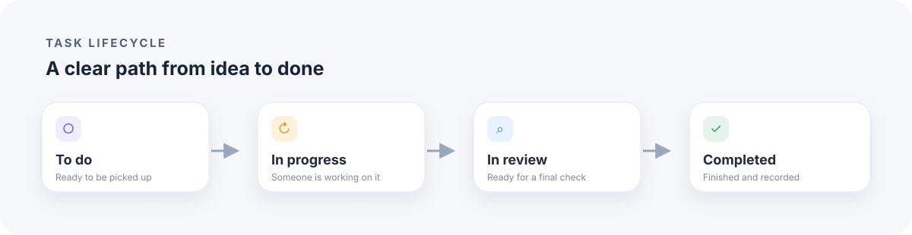
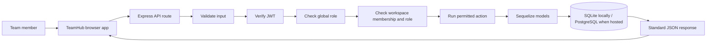
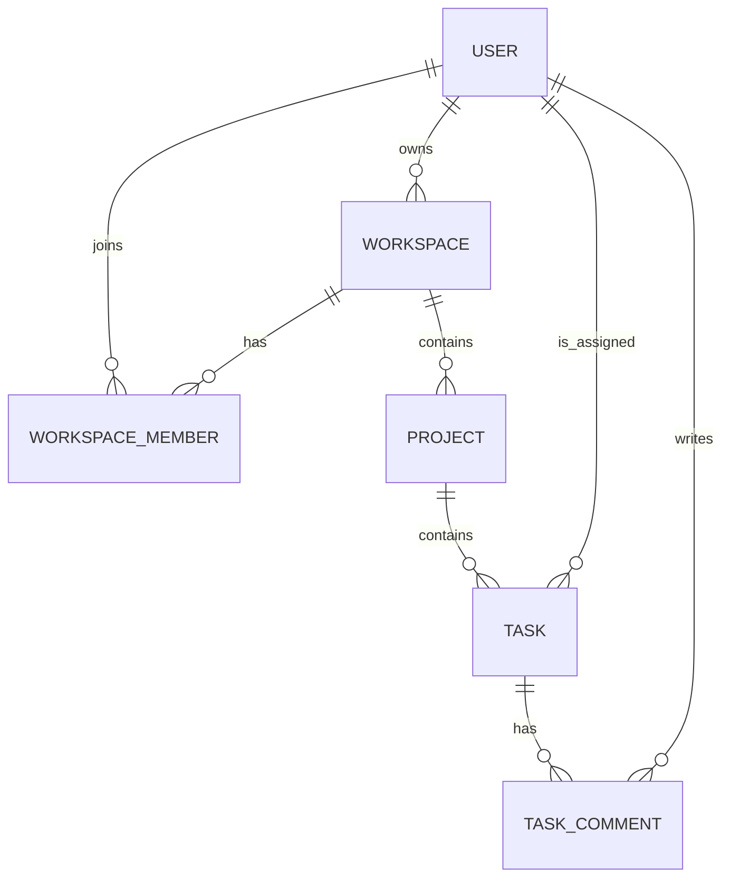

<div align="center">

# TeamHub RBAC

**A secure project and task workspace for small teams.**

Built with Node.js, Express, Sequelize, SQLite/PostgreSQL, and a responsive browser interface.

[Live application](https://teamhub-rbac.onrender.com) · [API health](https://teamhub-rbac.onrender.com/api/health) · [Postman collection](postman/TeamHub-RBAC.postman_collection.json)

**Author: Rachit Tripathi**

</div>

---

## Product preview

> Live demo: [teamhub-rbac.onrender.com](https://teamhub-rbac.onrender.com). The free service may take 50 seconds or more to wake after inactivity.



## What it does

TeamHub helps a team organize work in a shared workspace. A workspace contains projects; projects contain tasks. Teammates can be assigned to work, move tasks through a Kanban workflow, and discuss tasks with comments.

- Create an account and manage your profile and password.
- Create workspaces and manage their members.
- Give people global roles and workspace-specific roles.
- Create projects and assign tasks with priority, status, and due dates.
- View tasks in a list or group them by status on the Kanban board.
- Add comments, search and filter tasks, and review dashboard summaries.
- Use administrator routes to review accounts and change global roles.

## Screens and workflow

The main workflow moves each task through four clear stages:



### How a request is checked



A signed-in user sends a request with a bearer token. TeamHub validates the input, confirms the user's identity, then checks both global role and workspace membership before changing protected data.

### Data model



## Roles and access

| Role | What it can do |
| --- | --- |
| Global administrator | Review users and dashboards; change global roles; access workspaces |
| Global manager | Manage assigned tasks and receives manager-level workspace permissions when a member |
| Workspace owner | Manage workspace settings, members, projects, and tasks; transfer ownership |
| Workspace manager | Manage workspace members, projects, and tasks within the allowed role limits |
| Workspace member | View workspace work, comment, and change the status of assigned tasks |

Public registration always creates a regular member account. Global administrator access is created separately with the seed command. The API checks permissions on the server; hiding a button in the browser is never the only access check.

## API overview

All successful responses use `{ "success": true, "data": ... }`. Errors include a message and request ID. Protected endpoints require `Authorization: Bearer <token>`.

| Area | Example endpoints |
| --- | --- |
| Authentication and profile | `POST /api/auth/register`, `POST /api/auth/login`, `GET/PATCH /api/auth/profile`, `POST /api/auth/change-password` |
| User and admin dashboards | `GET /api/user/dashboard`, `GET /api/admin/dashboard`, `GET /api/admin/users` |
| Workspaces and membership | `/api/workspaces`, `/api/workspaces/:id/members`, ownership transfer |
| Projects | `/api/workspaces/:workspaceId/projects`, `/api/projects/:id` |
| Tasks and board | `/api/tasks`, `/api/tasks/board`, `/api/projects/:projectId/tasks`, `/api/tasks/:id/comments` |
| Health | `GET /api/health` |

See the endpoint tables below for permissions and query parameters. Task statuses are `todo`, `in_progress`, `review`, and `completed`. Priorities are `low`, `medium`, `high`, and `urgent`.

<details>
<summary>Endpoint and access reference</summary>

### Authentication and user routes

| Method | Endpoint | Access |
| --- | --- | --- |
| `GET` | `/api/health` | Public |
| `POST` | `/api/auth/register` | Public; creates a member |
| `POST` | `/api/auth/login` | Public |
| `GET` | `/api/auth/profile` | Signed in |
| `PATCH` | `/api/auth/profile` | Signed in |
| `POST` | `/api/auth/change-password` | Signed in |
| `GET` | `/api/user/dashboard` | Signed in |
| `GET` | `/api/admin/dashboard` | Global administrator |
| `GET` | `/api/admin/users?page=1&limit=20&search=sam&role=member` | Global administrator |
| `PATCH` | `/api/admin/users/:id/role` | Global administrator |

### Workspace, project, and task routes

| Method | Endpoint | Access |
| --- | --- | --- |
| `GET`, `POST` | `/api/workspaces` | Signed in; create a workspace you own |
| `GET`, `PATCH`, `DELETE` | `/api/workspaces/:id` | Member to read; owner/admin to change |
| `POST` | `/api/workspaces/:id/transfer-ownership` | Owner/admin |
| `GET`, `POST`, `PATCH`, `DELETE` | `/api/workspaces/:id/members` | Member to read; owner/manager/admin to manage |
| `GET`, `POST` | `/api/workspaces/:workspaceId/projects` | Member to read; owner/manager/admin to create |
| `GET`, `PATCH`, `DELETE` | `/api/projects/:id` | Member to read; owner/manager/admin to change |
| `POST` | `/api/projects/:projectId/tasks` | Owner/manager/admin |
| `GET` | `/api/tasks?workspaceId=1&status=todo&priority=high&search=design` | Signed in; accessible workspaces only |
| `GET` | `/api/tasks/board?workspaceId=1` | Workspace member |
| `GET`, `PATCH`, `DELETE` | `/api/tasks/:id` | Member to read; owner/manager/admin to change |
| `PATCH` | `/api/tasks/:id/status` | Assignee, workspace owner/manager, or admin |
| `GET`, `POST` | `/api/tasks/:id/comments` | Workspace member |

</details>

## Run locally

**Requirements:** Node.js 18 or newer and npm.

```bash
npm install
cp .env.example .env
```

Set a private `JWT_SECRET` of at least 32 characters in `.env`, then run:

```bash
npm run dev
```

Open [http://localhost:8000](http://localhost:8000). Local development uses SQLite and stores data in `database.sqlite`. Set `DB_STORAGE` to use another path. To use PostgreSQL locally or in a hosted environment, set `DATABASE_URL`; set `DATABASE_SSL=true` when the provider requires TLS.

### Create the first administrator

Public sign-up cannot grant admin access. To create the first administrator, set these environment variables and run the one-time seed command:

```bash
SEED_ADMIN_NAME="TeamHub Administrator" \
SEED_ADMIN_EMAIL="admin@your-company.com" \
SEED_ADMIN_PASSWORD="a-unique-password-at-least-12-characters" \
npm run seed:admin
```

The command will not promote an existing member account. Change the sample values before running it.

## Verify with Postman

Import [`postman/TeamHub-RBAC.postman_collection.json`](postman/TeamHub-RBAC.postman_collection.json) into Postman. Use the disposable local test database shown below so the checks cannot modify the normal development database.

Set `TEAMHUB_TEST_JWT_SECRET` and `TEAMHUB_TEST_ADMIN_PASSWORD` to disposable values in your local shell. The Postman collection and environment example leave password and token values blank on purpose; enter the same disposable account passwords in the local Postman environment before running the checks.

First terminal:

```bash
PORT=8010 \
DB_STORAGE=/tmp/teamhub-postman.sqlite \
JWT_SECRET="$TEAMHUB_TEST_JWT_SECRET" \
SEED_ADMIN_EMAIL="admin@example.test" \
SEED_ADMIN_PASSWORD="$TEAMHUB_TEST_ADMIN_PASSWORD" \
npm run seed:admin
```

Second terminal:

```bash
PORT=8010 DB_STORAGE=/tmp/teamhub-postman.sqlite JWT_SECRET="$TEAMHUB_TEST_JWT_SECRET" npm run dev
```

Run the collection in order. It checks sign-up and login, validation, authorization, profiles, dashboards, workspace membership, project and task CRUD, filters, Kanban grouping, comments, and cleanup. The collection uses local-only example credentials. Remove `/tmp/teamhub-postman.sqlite` after the run if you no longer need it.

## Deploy

The live demo runs on Render and uses PostgreSQL. `render.yaml` documents the web service, Node.js start command, health check, and generated JWT secret. The hosted service reads its private database connection from `DATABASE_URL`; `DATABASE_SSL=true` enables TLS for managed PostgreSQL providers.

The current free Render Postgres database is scheduled to expire on November 9, 2026. Upgrade or migrate the database before then if the demo must keep its data. The free web service can sleep after inactivity, so its first response may take 50 seconds or more. Keep this demo data-only and do not store real personal or company information. See [Render's free instance limits](https://render.com/docs/free).

## Repository layout

```text
app.js                 Express middleware, routes, and static browser app
server.js              Application startup, database connection, health endpoint
config/database.js     SQLite locally; PostgreSQL when DATABASE_URL is set
models/                User, workspace, membership, project, task, comment
controllers/            API handlers
routes/                 Auth, user, admin, workspace, project, task endpoints
services/access.js      Workspace permission checks
middleware/             JWT authentication, rate limiting, error handling
utils/                  Validation and HTTP errors
public/                 Browser pages, styles, and client-side flows
postman/                Importable API test collection and environment
scripts/seedAdmin.js    Explicit first-administrator setup
.github/workflows/      Continuous integration checks
```

---

**Created by [Rachit Tripathi](https://github.com/rachit1807).**
